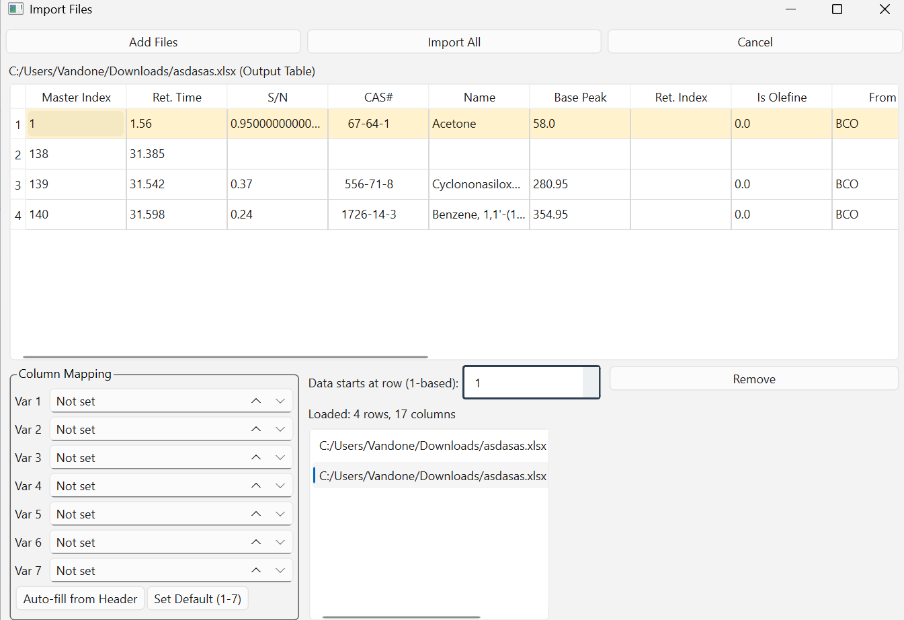

# import_preview

Reusable PySide6 import window with preview, column mapping, and variable extraction.

## Usage

```python
from PySide6.QtWidgets import QApplication
from app.ui.import_window import ImportWindow
from app.services.importer import normalize_table, load_file, load_file_sheet

app = QApplication([])
window = ImportWindow()
def on_imported(configs):
    frames = []
    for c in configs:
        df = load_file_sheet(c["file_path"], c["sheet_name"]) if c["sheet_name"] else load_file(c["file_path"])
        table = normalize_table(df, c["column_mapping"], c["starting_row"], c["file_path"], c["source_type"], c["source_identifier"])
        frames.append(table.dataframe)
    merged = __import__("pandas").concat(frames, ignore_index=True)
window.filesImported.connect(on_imported)
window.show()
app.exec()
```

## Structure

- `app/models/table.py` - `Table` dataclass
- `app/services/importer.py` - loading, preview, normalization
- `app/ui/import_window.py` - `ImportWindow`, `FileConfigWidget`
- `test_import_ui.py` - runnable UI/functionality test

## Run

```bash
python test_import_ui.py
```

